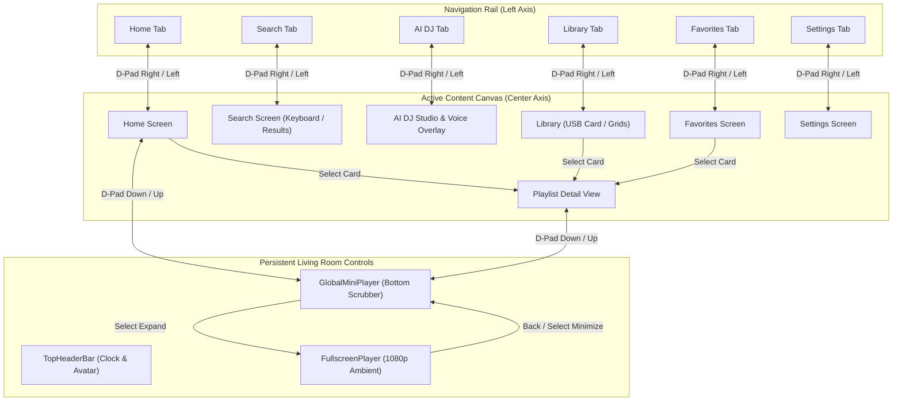

# Pandivo TV: 10-Foot Living Room Pages & UI Architecture 📺✨

## Overview

**Pandivo TV** is engineered specifically for the 10-foot television experience on **Amazon Fire TV (Fire OS 7/8)** and **Android TV / Google TV**. 

The user interface follows Amazon Appstore Design Guidelines, strictly maintaining:
- **5% TV Overscan Margin Compliance** (content safe zones: 96px horizontal, 54px vertical at 1080p).
- **Spatial D-Pad Remote Navigation** with deterministic focus transitions and zero dead-ends.
- **High-Contrast Visual Feedback** (glowing focus rings, scale transforms, vibrant active states).
- **Persistent Audio Chassis** (Global MiniPlayer with seamless background playback).

---

## 🗺️ Master Screen Directory

| # | Screen / Page | Primary Component File | Nav Tab / Route | Description & Key Responsibilities |
|---|---|---|---|---|
| **01** | [**Home Screen**](./01_HOME_SCREEN.md) | `FireTVMusicPOC/src/components/home/HomeScreen.tsx` | `HOME` | Dynamic time-of-day hero greeting, Recently Played carousel, and algorithmic recommendations. |
| **02** | [**AI DJ Screen**](./02_AI_DJ_SCREEN.md) | `FireTVMusicPOC/src/components/AiDjScreen.tsx` | `AI_DJ` | Conversational voice AI playlist generation using Amazon Bedrock Nova Lite & Gemini. |
| **03** | [**Search Screen**](./03_SEARCH_SCREEN.md) | `FireTVMusicPOC/src/components/SearchScreen.tsx` | `SEARCH` | 7x5 TV on-screen keyboard, Whistle offline voice search, and Audius catalog indexing. |
| **04** | [**Library Screen**](./04_LIBRARY_SCREEN.md) | `FireTVMusicPOC/src/components/LibraryScreen.tsx` | `LIBRARY` | Central hub for USB storage media, liked collections, AI playlists, and custom mixes. |
| **05** | [**Favorites Screen**](./05_FAVORITES_SCREEN.md) | `FireTVMusicPOC/src/components/FavoritesScreen.tsx` | `FAVORITES` | Dedicated liked tracks hero card, bulk shuffle action, and interactive favorites list. |
| **06** | [**Playlist Detail**](./06_PLAYLIST_DETAIL_SCREEN.md) | `FireTVMusicPOC/src/components/PlaylistScreen.tsx` | `SELECTED_PLAYLIST` | Full playlist view with track scrubber, play/shuffle actions, and live equalizer. |
| **07** | [**Fullscreen Player**](./07_FULLSCREEN_PLAYER_SCREEN.md) | `FireTVMusicPOC/src/components/FullscreenPlayerScreen.tsx` | `FULLSCREEN` | Ambient 1080p video backgrounds, rotating vinyl animation, scrub bar, and queue drawer. |
| **08** | [**Settings Screen**](./08_SETTINGS_SCREEN.md) | `FireTVMusicPOC/src/components/SettingsScreen.tsx` | `SETTINGS` | Companion avatar selection, audio quality, privacy-first disclosure, and cache controls. |
| **09** | [**Avatar Selection**](./09_AVATAR_SELECTION_SCREEN.md) | `FireTVMusicPOC/src/components/AvatarSelectionScreen.tsx` | `AVATAR_MODAL` | 5 high-res 3D companion characters with SQLite persistence and DynamoDB cloud sync. |
| **10** | [**Global Chassis**](./10_GLOBAL_CHASSIS_AND_NAVIGATION.md) | `FireTVMusicPOC/src/components/layout/` | *Persistent* | CollapsibleNavRail, TopHeaderBar, GlobalMiniPlayer, and Modal Focus Traps. |

---

## 🧭 Spatial Navigation Graph Architecture

---

## 🛡️ Core Living Room Principles

1. **Zero Dead-Ends**: Every screen and state has deterministic spatial transitions. If focus is ever lost during dynamic async events (e.g. cloud sync or modal exit), the navigation system automatically self-heals back to the logical primary element.
2. **Audio Continuity**: Navigation between tabs never interrupts background music streaming. Playback remains continuous via `expo-audio` singleton orchestration.
3. **Hardware Acceleration**: All focus indicators, glowing neon borders, and scrolling lists utilize native layout transforms (`transform: [{ scale }]`) running strictly at 60 FPS on Amazon Fire TV hardware.
