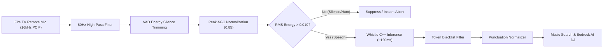

# Speech AI, Audio DSP & Generative AI Hub 🎙️🧠

Welcome to the **Speech AI & Intelligence Hub** for Pandivo TV. This directory documents the cutting-edge speech processing, digital signal processing (DSP), C++ JNI inference, and multi-tier generative AI architectures powering the living room experience.

---

## 📚 Documents in this Suite

| Document | Focus | Key Topics |
|---|---|---|
| [**`SPEECH_TO_TEXT_PROBLEMS_AND_SOLUTIONS.md`**](./SPEECH_TO_TEXT_PROBLEMS_AND_SOLUTIONS.md) | **Audio DSP & Speech Recognition** | TV remote microphone gain issues, 80Hz HPF, VAD silence trimming, AGC peak normalizer, pre-inference RMS energy gating, silence hallucination elimination, Aho-Corasick phrase biasing, punctuation-agnostic search parity. |
| [**`OFFLINE_SPEECH_RECOGNITION_FIX.md`**](./OFFLINE_SPEECH_RECOGNITION_FIX.md) | **Native C++ Engine & JNI Architecture** | Embedded Whistle AI inference (`libwhistle_native.so` + `libneedle.a`), 16.9 MB quantized acoustic model (`whistle.cact`), dual-ABI packaging (`arm64-v8a` + `x86_64`), Android Bionic shims, and zero cloud dependencies. |
| [**`TECH_STACK_AND_PACKAGES.md`**](./TECH_STACK_AND_PACKAGES.md) | **Technology Stack & Dependencies** | Comprehensive breakdown of all production dependencies, native libraries, licenses, architecture rationale, and Hermes engine configuration. |

---

## 🎙️ The TV Remote Speech Dilemma

Standard mobile voice assistants assume a phone held 2–3 inches from the speaker's mouth in a quiet room. In contrast, **Amazon Fire TV** presents a harsh acoustic environment:
1. **Low-Gain Remote Microphones**: Remote Bluetooth mics capture faint audio with low SNR (Signal-to-Noise Ratio).
2. **Subwoofer & Television Rumble**: Low-frequency audio from TV speakers and subwoofers leaks into the remote microphone.
3. **Silence Hallucinations**: Neural STT decoders hallucinate phantom subtitle phrases (e.g., *"Thank you for watching"*, *"Please subscribe"*) when fed trailing silence or background hum.

### How Pandivo Solves This:

---

## 🧠 3-Tier Resilient Generative AI Cascade

Pandivo TV ensures uninterrupted playback and intelligence even during partial cloud outages or complete offline disconnection:

1. **Tier 1 (Primary - Cloud)**: **Amazon Bedrock (Nova Lite `amazon.nova-lite-v1:0`)**
   - Sub-second natural language vibe extraction and radio-host commentary (~550ms).
   - 3.5-second client timeout ensures the TV interface never hangs.
2. **Tier 2 (Secondary - Fallback Cloud)**: **Google Gemini 3.5 Flash**
   - Automatically engaged if Bedrock throttles, times out, or encounters AWS IAM latency.
3. **Tier 3 (Tertiary - 100% Offline Local)**: **Deterministic Heuristic Engine**
   - Instant 0ms fallback with zero network required; scores and transitions music based on BPM and acoustic mood attributes.
