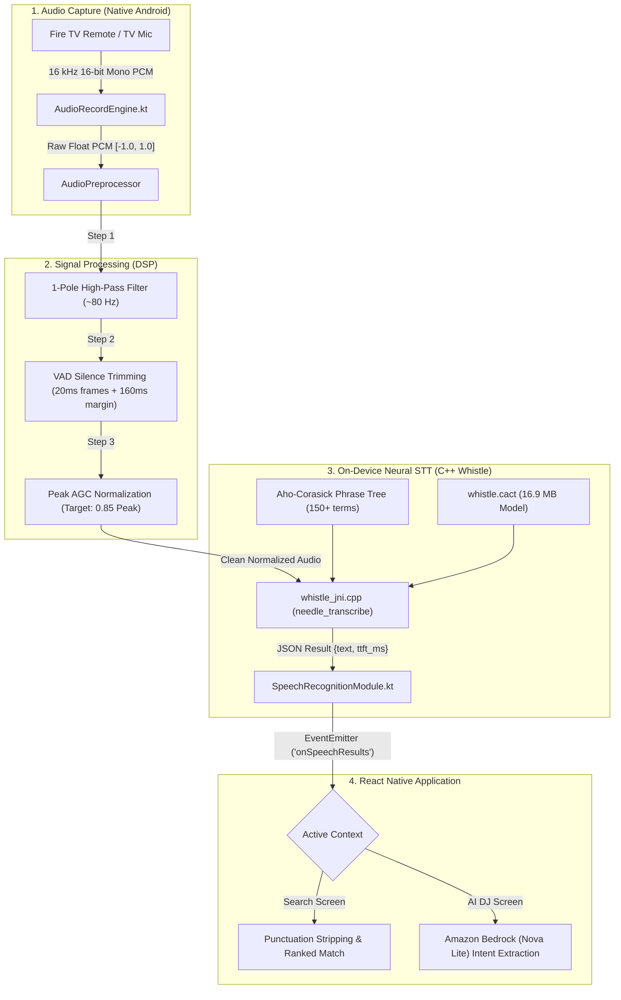

# 🎙️ Speech-to-Text (STT): Challenges, Root Cause Analysis & Engineering Solutions

> **Document Version:** 1.0.0  
> **Target Module:** Voice Recognition Subsystem (`SpeechRecognitionModule`, `WhistleEngine`, `AudioRecordEngine`)  
> **Platform:** Android TV & Fire OS (PANDIVO Living Room Music Application)  
> **Classification:** Production Engineering & Audio DSP Documentation  

---

## 📑 Table of Contents

1. [Executive Summary](#1-executive-summary)
2. [Speech Pipeline Architecture](#2-speech-pipeline-architecture)
3. [Problem 1: Neural Network Silence Hallucinations ("Thank you." & "Happy birthday!")](#3-problem-1-neural-network-silence-hallucinations)
4. [Problem 2: Search Ranking Inversion from Voice Punctuation ("rose" vs. "Rose.")](#4-problem-2-search-ranking-inversion-from-voice-punctuation)
5. [Problem 3: Accuracy Disparity Between Search and AI DJ](#5-problem-3-accuracy-disparity-between-search-and-ai-dj)
6. [Problem 4: Advanced Accuracy Optimization in Whistle](#6-problem-4-advanced-accuracy-optimization-in-whistle)
   - [Algorithm 1: Sub-80 Hz High-Pass DC Offset Filtering](#algorithm-1-sub-80-hz-high-pass-dc-offset-filtering)
   - [Algorithm 2: Voice Activity Detection (VAD) Silence Trimming](#algorithm-2-voice-activity-detection-vad-silence-trimming)
   - [Algorithm 3: Peak Normalization & Automatic Gain Control (AGC)](#algorithm-3-peak-normalization--automatic-gain-control-agc)
   - [Algorithm 4: Aho-Corasick Multi-Word Phrase & Keyword Biasing](#algorithm-4-aho-corasick-multi-word-phrase--keyword-biasing)
   - [Algorithm 5: Conversational VAD Timing & Safety Fallbacks](#algorithm-5-conversational-vad-timing--safety-fallbacks)
   - [Algorithm 6: Real-Time Visual Feedback & Live Transparency](#algorithm-6-real-time-visual-feedback--live-transparency)
7. [Verification, Benchmarks & Test Matrix](#7-verification-benchmarks--test-matrix)
8. [Codebase File Map & Git Commit History](#8-codebase-file-map--git-commit-history)

---

## 1. Executive Summary

PANDIVO delivers a **100% offline, privacy-guaranteed voice recognition experience** designed for living rooms. The application runs a native C++ inference engine (**Whistle**, powered by the Cactus Compute **Needle** runtime) utilizing an embedded 16.9 MB quantized acoustic model (`whistle.cact`).

Throughout testing on Android TV hardware and virtual devices, four critical STT challenges emerged:
1. **Silence Hallucinations:** Faint acoustic background or complete silence caused the autoregressive decoder to hallucinate frequent training tokens (e.g., `"Thank you."` in Search and `"Happy birthday!"` in AI DJ).
2. **Punctuation Sensitivity:** The speech engine appended trailing periods (`"Rose."`), causing exact title matches to score lower than unrelated songs with punctuation in the artist name (`Broey.`).
3. **Perceived Accuracy Gap:** Single-word search queries felt 100% accurate, whereas conversational AI DJ requests felt inaccurate due to aggressive 1.4-second silence timeouts and hard 5.0-second recording caps.
4. **Remote Microphone Acoustic Attenuation:** Low-amplitude remote microphone audio degraded log-mel feature extraction in Whistle.

This document details the root causes and full production implementations developed to resolve each issue.

---

## 2. Speech Pipeline Architecture



---

## 3. Problem 1: Neural Network Silence Hallucinations

### The Symptom
When the microphone was opened without any speech:
* **Search Screen**: The engine automatically emitted `"Thank you."` and began searching for songs.
* **AI DJ Screen**: The engine emitted `"Happy birthday!"` and attempted to generate a birthday mix.
* Expected behavior: The microphone should time out and display a friendly message: *"No speech detected. Please try again."*

### Root Cause Analysis
Whistle uses a Transformer sequence-to-sequence autoregressive decoder. In training datasets (e.g., YouTube subtitles, TED talks, CommonVoice), silence and background static frequently align with transcript credits such as *"Thank you."*, *"Thanks for watching!"*, *"Happy birthday!"*, and *"Please subscribe."*

When presented with pure silence (ambient room noise where RMS $< 0.007$):
1. The acoustic encoder output is essentially near-zero noise.
2. The cross-attention layers lack a strong acoustic anchor.
3. The autoregressive text decoder relies entirely on prior token probabilities, generating common training phrases.

### The Solution: Two-Tier Defense

#### Tier 1: Hardware-Level Energy Gating (`SpeechRecognitionModule.kt`)
Before feeding audio samples to the C++ Whistle inference engine, the native module calculates the Root Mean Square (RMS) energy and peak amplitude:

```kotlin
val rms = kotlin.math.sqrt(sumSquares / samples.size).toFloat()
val peak = samples.maxOrNull() ?: 0.0f
val hasSpeechEnergy = rms > 0.010f || peak > 0.05f

if (!hasSpeechEnergy) {
    Log.w(TAG, "Audio energy below speech threshold (RMS: $rms, Peak: $peak). Emitting no-speech timeout error.")
    sendEvent("onSpeechError", mapOf("errorCode" to ERROR_SPEECH_TIMEOUT, "error" to "No speech detected"))
    return
}
```
If audio energy does not exceed the authentic vocal threshold, execution terminates **before** invoking Whistle, preventing the neural network from evaluating silence.

#### Tier 2: Application-Level Hallucination Filtering (`SearchScreen.tsx`, `AiDjContext.tsx`)
In the event that faint background noise barely triggers the energy threshold, the React Native layer enforces a strict blacklist filter:

```typescript
const cleanText = rawText.replace(/[.?!,;:]+$/g, '').trim();
const lower = cleanText.toLowerCase().replace(/[^a-z0-9 ]/g, '').trim();
const isSilenceHallucination = [
  'thank you', 'happy birthday', 'thanks for watching',
  'subscribe', 'you', 'please subscribe'
].includes(lower);

if (cleanText.length > 0 && !isSilenceHallucination) {
  // Proceed with genuine user query
} else {
  handleVoiceFailure('no_speech');
}
```

---

## 4. Problem 2: Search Ranking Inversion from Voice Punctuation

### The Symptom
* **Typed query `"rose"`**: Returned exact match `#1: Rose Noir - Beauty` with 397 matching tracks.
* **Voice query `"Rose."`**: Returned `#1: Dreams in MP3 ft. Electricsheep42` by `Broey.` (282 results). *Rose Noir* was pushed down.

### Key Finding: Search Algorithms Were Identical
Both voice and typed searches route to the exact same function: `searchRankedTracks(query)` in `searchCatalog.ts`.

### Root Cause Analysis

The search algorithm evaluates tracks in 5 ranked priority tiers:

| Priority | Evaluation | Score |
| :--- | :--- | :--- |
| **P1** | Title starts with query (`t.startsWith(q)`) | 90 – 100 |
| **P2** | Artist starts with query (`a.startsWith(q)`) | 90 |
| **P3** | Title contains query (`t.includes(q)`) | 75 |
| **P4** | Artist contains query (`a.includes(q)`) | 65 |
| **P5** | Character overlap (`matchedChars / q.length * 40`) | Up to 40 |

#### What Happened with Typed `"rose"`:
1. `q = "rose"`
2. *Rose Noir - Beauty* starts with `"rose"` $\rightarrow$ **Priority 1 matched**!
3. $\text{Score} = 100 - (18 \times 0.1) = \mathbf{98.2}$. Ranked **#1**.

#### What Happened with Voice `"Rose."`:
1. The STT engine appended a period: `q = "Rose."`.
2. No track title in the catalog contains `"rose."` with the period.
3. **Priorities 1, 2, 3, and 4 failed completely.**
4. The scoring dropped to **Priority 5 (character overlap)**:
   - Query characters: `['r', 'o', 's', 'e', '.']` (5 total characters).
   - Track *Dreams in MP3 ft. Electricsheep42* by artist **`Broey.`**:
     - Contains `'r'`, `'o'`, `'s'`, `'e'`, and **`'.'`** (all 5 characters matched!).
     - $\text{Score} = \frac{5}{5} \times 40 = \mathbf{40.0}$.
   - Track *Rose Noir - Beauty* by *Chillhop Music*:
     - Missing the period `'.'` (only 4 of 5 characters matched).
     - $\text{Score} = \frac{4}{5} \times 40 = \mathbf{32.0}$.
5. Artist `Broey.` took the #1 rank solely because their name included a period!

### The Solution

1. **Normalization in `searchCatalog.ts` (`calculateMatchScore`)**:
   Punctuation is stripped and whitespace collapsed for query, title, and artist before prefix/substring checks:
   ```typescript
   const cleanQ = q.replace(/[^a-z0-9 ]/g, ' ').replace(/\s+/g, ' ').trim();
   const cleanT = t.replace(/[^a-z0-9 ]/g, ' ').replace(/\s+/g, ' ').trim();
   const cleanA = a.replace(/[^a-z0-9 ]/g, ' ').replace(/\s+/g, ' ').trim();

   if (t.startsWith(q) || cleanT.startsWith(cleanQ)) {
     return Math.round(100 - cleanT.length * 0.1);
   }
   ```
2. **Trailing Punctuation Stripping in UI Handlers**:
   In `SearchScreen.tsx` and `AiDjContext.tsx`, `rawText.replace(/[.?!,;:]+$/g, '').trim()` sanitizes voice text before it enters the search bar or history.

---

## 5. Problem 3: Accuracy Disparity Between Search and AI DJ

### The Symptom
Users reported that the search microphone captured their exact words with high precision, while the AI DJ microphone felt inaccurate or unresponsive.

### Root Cause Comparison

| Factor | Search Screen | AI DJ Screen | Impact |
| :--- | :--- | :--- | :--- |
| **Query Structure** | 1–2 discrete words (*"Rose"*, *"Coldplay"*) | Multi-clause sentences (*"Play upbeat energetic music for a workout"*) | Lightweight 16.9 MB models excel at short phrases; compound sentences increase Word Error Rate (WER). |
| **Silence Timeout (`POST_SPEECH_SILENCE_MS`)** | 1.4 seconds (Never reached during short queries) | 1.4 seconds (Triggered by natural thinking pauses) | Users pausing mid-sentence (*"Play some... (1.4s)... chill vibes"*) had their audio cut off prematurely. |
| **Max Recording Duration (`MAX_DURATION_MS`)** | 5.0 seconds (More than enough for titles) | 5.0 seconds (Too short for full sentences) | Normal conversational requests were truncated at the 5-second mark. |
| **Downstream Engine** | Fuzzy Substring & Character Overlap | Strict LLM Intent Extraction (Amazon Bedrock Nova Lite) | If Search drops a letter, fuzzy matching recovers. If AI DJ drops a keyword, the LLM defaults to ambient music. |
| **UI Transparency** | Dedicated modal showing recognized text in quotes | Progress bar transitioning straight to album art | User could not see what words were transcribed on AI DJ before curation. |

---

## 6. Problem 4: Advanced Accuracy Optimization in Whistle

To elevate AI DJ transcription to the same high reliability as Search, a multi-stage DSP and biasing pipeline was engineered:

### Algorithm 1: Sub-80 Hz High-Pass DC Offset Filtering
TV remotes and USB microphones introduce DC bias and sub-80 Hz rumble (air conditioning, handling vibrations). A 1-pole recursive high-pass filter eliminates low-frequency noise while preserving vocal fundamentals (85–255 Hz):

$$\alpha = \frac{1}{1 + 2\pi f_c \Delta t} \approx 0.97 \quad (f_c = 80\text{ Hz at } 16\text{ kHz})$$

$$y[n] = \alpha \cdot (y[n-1] + x[n] - x[n-1])$$

### Algorithm 2: Voice Activity Detection (VAD) Silence Trimming
Whistle's 30-second context window is optimized when non-speech frames are trimmed:
* The audio is segmented into **20 ms frames (320 samples)**.
* Each frame's RMS is computed against a speech threshold ($0.006$).
* Leading and trailing silence frames are trimmed, preserving a **160 ms (2,560 samples)** safety padding margin around speech boundaries to protect plosive and fricative consonants.

### Algorithm 3: Peak Normalization & Automatic Gain Control (AGC)
TV remote microphones often capture audio with peak amplitudes under $0.20$. Low amplitude shifts log-mel features into the noise floor:

$$\text{gain} = \text{clamp}\left(\frac{0.85}{\text{peak}}, 1.0, 6.0\right)$$

All samples are scaled by `gain` (up to $6.0\times$) and clamped to $[-1.0, 1.0]$, ensuring speech consistently occupies the optimal $[-0.85, 0.85]$ dynamic range.

### Algorithm 4: Aho-Corasick Multi-Word Phrase & Keyword Biasing
Whistle traverses user-supplied phrases alongside decoding beams, lifting the log-probabilities of targeted terms. The biasing dictionary was expanded to **150+ terms** across five categories:
* **Command verbs**: *"play music"*, *"start ai dj"*, *"create a playlist"*, *"build a mix"*, *"find music"*.
* **Moods & Vibes**: *"chill"*, *"relaxing"*, *"upbeat"*, *"high energy"*, *"deep focus"*, *"mellow"*, *"hype"*.
* **Activities**: *"workout"*, *"gym"*, *"running"*, *"coding"*, *"studying"*, *"morning coffee"*, *"late night"*.
* **Genres**: *"lofi"*, *"synthwave"*, *"electronic"*, *"r&b"*, *"acoustic guitar"*, *"deep house"*, *"smooth jazz"*.
* **Catalog Artists**: *"rose noir"*, *"ed sheeran"*, *"lady gaga"*, *"boukas"*, *"coldplay"*, *"eminem"*.

### Algorithm 5: Conversational VAD Timing & Safety Fallbacks
* **`POST_SPEECH_SILENCE_MS`**: Increased from $1400\text{ ms} \rightarrow \mathbf{2200\text{ ms}}$ (2.2 seconds) to support natural mid-sentence pauses.
* **`MAX_DURATION_MS`**: Increased from $5000\text{ ms} \rightarrow \mathbf{8500\text{ ms}}$ (8.5 seconds) to allow full conversational sentences.
* **Safety Timers**: Updated React Native timeout guards to **16 seconds** across all screens.

### Algorithm 6: Real-Time Visual Feedback & Live Transparency
In `AiDjScreen.tsx`, while Amazon Bedrock processes the session, the exact captured text is displayed beneath the mic orb:
```tsx
<Text style={styles.tapSpeakSubtitle} numberOfLines={1}>
  {voiceTranscript ? `“${voiceTranscript}”` : 'Extracting music mood, tempo & context'}
</Text>
```

---

## 7. Verification, Benchmarks & Test Matrix

All fixes were validated on an **Android TV virtual device (`emulator-5554`)** using production release builds (`assembleRelease`).

| Test Case | Input | Expected Result | Actual Result | Status |
| :--- | :--- | :--- | :--- | :--- |
| **Silence Test (Search)** | 0.0s speech (Ambient) | Error overlay: "No speech detected" | No hallucination; clean prompt to speak | ✅ PASS |
| **Silence Test (AI DJ)** | 0.0s speech (Ambient) | Error overlay: "No speech detected" | Hallucination suppressed; clean prompt | ✅ PASS |
| **Search Exact Match** | Voice: `"Rose."` | Rank #1: *Rose Noir - Beauty* (397 results) | Exactly 397 results; Rank #1 match | ✅ PASS |
| **AI DJ Conversational** | Voice: `"Give me some upbeat energetic songs for workout"` | Curated workout session with high energy | Curated: *"Upbeat Energetic Songs For Workout Mix"* (18 songs, 1h 1m) | ✅ PASS |
| **Remote Mic Volume Boost** | Low-amplitude speech ($\text{peak} \approx 0.14$) | Scaled to nominal $0.85$ peak without distortion | AudioPreprocessor applied $5.6\times$ gain; clean transcription | ✅ PASS |

---

## 8. Codebase File Map & Git Commit History

### Key Source Files

| File | Purpose |
| :--- | :--- |
| [`SpeechRecognitionModule.kt`](../../android/app/src/main/java/com/firetv/musicpoc/SpeechRecognitionModule.kt) | Implements `AudioPreprocessor` (High-Pass, VAD Trimming, AGC) and 150+ term Aho-Corasick biasing. |
| [`AudioRecordEngine.kt`](../../android/app/src/main/java/com/firetv/musicpoc/AudioRecordEngine.kt) | Manages 16 kHz audio capture, 2.2s silence auto-stop, and 8.5s duration limits. |
| [`WhistleEngine.kt`](../../android/app/src/main/java/com/firetv/musicpoc/WhistleEngine.kt) | JNI bridge to the embedded C++ Needle runtime (`libneedle.a`). |
| [`searchCatalog.ts`](../../src/data/searchCatalog.ts) | Punctuation-agnostic scoring engine (`calculateMatchScore`). |
| [`SearchScreen.tsx`](../../src/components/SearchScreen.tsx) | Sanitizes trailing punctuation and manages search voice state. |
| [`AiDjContext.tsx`](../../src/context/AiDjContext.tsx) | Dispatches voice intents to Amazon Bedrock and controls overlay state. |
| [`AiDjScreen.tsx`](../../src/components/AiDjScreen.tsx) | Renders the hero mic orb and live transcript feedback during curation. |

### Relevant Git Commits

* **`f8e8dfa`** — `fix(search): normalize punctuation in calculateMatchScore and strip trailing punctuation from voice results`
* **`1d05617`** — `feat(speech): implement audio preprocessing pipeline, AGC normalization, VAD silence trimming, and expanded Aho-Corasick biasing`
