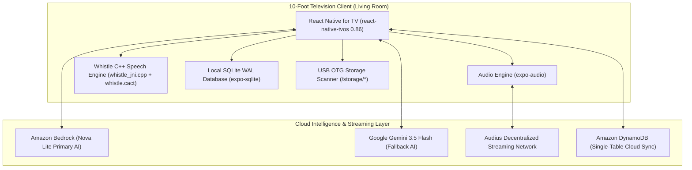

# Technology Stack & Package Architecture 🛠️📦

## Overview

**Pandivo TV** is a high-performance, 10-foot living-room music and continuous AI DJ platform engineered specifically for **Amazon Fire TV** (Fire OS 7+) and **Android TV** (API 30–34). It integrates an on-device C++ speech recognition engine, multi-tiered cloud AI (Amazon Bedrock + Google Gemini), local SQLite WAL persistence, Amazon DynamoDB cloud sync, decentralized Audius streaming, and plug-and-play USB external storage.

---

## 🏛️ Architecture & Technology Stack Breakdown



---

## 층 System Architecture by Domain

### 1. Television UI & Spatial Navigation Engine
- **Framework**: [React Native for TV](https://github.com/react-native-tvos/react-native-tvos) (`react-native-tvos@0.86-stable`)
- **UI Architecture**: Declarative React 19 (`19.2.3`) with functional hooks and memoized callback graphs.
- **D-Pad Spatial Navigation**: Custom deterministic directional graphs (`src/navigation/`) mapping every 10-foot UI element (`NAV_*`, `HERO_*`, `TRK_*`, `LIB_*`, `SRC_*`) to hardware D-pad movements with self-healing focus fallbacks.
- **Virtualization**: `@react-native-tvos/virtualized-lists` (`^0.81.0-0`) for smooth 60 FPS scrolling through large music catalogs.
- **JavaScript Engine**: **Hermes** bytecode engine (`hermes-android`) with Ahead-Of-Time (AOT) compilation for rapid cold boots on TV processors.

### 2. Edge AI & On-Device Speech Recognition (Whistle)
- **Model**: Bundled quantized acoustic model (`whistle.cact`, **16.9 MB** in `android/app/src/main/assets/`).
- **Core Library**: `libneedle.a` static C++ engine linked natively into `libwhistle_native.so`.
- **C++ JNI Bridge**: [`whistle_jni.cpp`](../../android/app/src/main/cpp/whistle_jni.cpp) compiled with **CMake 3.22.1** and **Android NDK 26.1.10909125** (`c++_shared` runtime).
- **Audio Capture**: Android `AudioRecord` circular buffer capturing 16 kHz mono float PCM samples with zero cloud latency.
- **Biasing Engine**: Music-specific keyword biasing (`lofi`, `chill`, `workout`, `synthwave`, `acoustic`, `ai dj`) to maximize accuracy on low-end TV microchips.
- **Standalone Package**: Extracted and published to npm as [**`react-native-whistle-tv-offline`**](https://www.npmjs.com/package/react-native-whistle-tv-offline) (v1.0.3).

### 3. Generative AI & Natural Language Music Understanding
- **Primary Cloud Orchestrator**: **Amazon Bedrock (Nova Lite)** via Serverless API Gateway / Lambda backend.
- **Secondary Cloud Fallback**: **Google Gemini (Gemini 3.5 Flash & Flash Lite)** via `geminiIntentService.ts`.
- **Offline Resilient Fallback**: Deterministic keyword extraction and progressive constraint relaxation state machine ensuring zero downtime when disconnected from the internet.
- **Contextual DJ Engine**: Real-time energy progression modeling (0.0 to 1.0), tempo/BPM balancing, artist repetition suppression, and generative voiceover commentary.

### 4. Local Database & Cloud Synchronization
- **Local Persistence**: **SQLite 3** via `expo-sqlite` (`~57.0.4`) operating in **Write-Ahead Logging (WAL)** mode.
- **Local Schemas**: `liked_songs`, `liked_playlists`, `user_preferences`, `playback_history`, `search_history`, `app_metadata`.
- **Cloud Database**: **Amazon DynamoDB** with single-table design (`PK: USER#<id>`, `SK: PROFILE`).
- **Sync Architecture**: Non-blocking, debounced background synchronization (`awsCloudSyncManager.ts`) ensuring cloud updates never stall TV rendering.

### 5. Audio Playback & Music Streaming
- **Audio Playback Engine**: `expo-audio` (`~57.0.5`) managing Android `MediaPlayer` audio sessions, background audio focus, and hardware play/pause/skip key interception.
- **Decentralized Streaming**: Audius decentralized music network with automatic node rotation.
- **Offline USB Playback**: Android `StorageManager` volume discovery and `MediaMetadataRetriever` ID3 tag scanner (supporting MP3, FLAC, WAV, AAC, M4A).
- **Queue Randomization**: Fisher-Yates (Knuth) shuffle algorithm anchoring the current track at index 0.

---

## 📦 Package & Dependency Matrix (`package.json`)

### Production Dependencies (`dependencies`)

| Package Name | Specified Version | Category | Architectural Responsibility in Pandivo TV |
|---|---|---|---|
| **`react-native`** | `npm:react-native-tvos@0.86-stable` | **Core TV Framework** | TV-specialized React Native fork. Adds Android TV Leanback focus engine, remote D-pad keyevent listeners, and removes mobile-only touch overhead. |
| **`react`** | `19.2.3` | **Core Library** | Component lifecycle, state management, context providers, and virtual DOM reconciliation. |
| **`react-dom`** | `19.2.3` | **Peer Dependency** | Required peer dependency for React 19 web and testing environments. |
| **`expo`** | `~57.0.13` | **Application Framework** | Expo managed runtime modules, lifecycle hooks, and native module autolinking. |
| **`expo-audio`** | `~57.0.5` | **Audio Engine** | High-performance native audio playback, buffer state observation, and remote media key routing. |
| **`expo-sqlite`** | `~57.0.4` | **Local Storage** | Local SQLite engine running in WAL mode for sub-millisecond favorites and playback history persistence. |
| **`expo-video`** | `~57.0.5` | **Video / Visuals** | Hardware-accelerated video decoding for animated living-room visualizer backgrounds. |
| **`expo-splash-screen`** | `~57.0.6` | **Boot UX** | Holds native splash screen during SQLite schema hydration and cloud sync initialization. |
| **`expo-status-bar`** | `~57.0.1` | **Screen UI** | Controls Android TV immersive fullscreen mode and status bar visibility. |
| **`@expo/vector-icons`** | `^15.0.2` | **Visual Icons** | Vector glyphs for TV remote HUD (heart, play, pause, shuffle, USB, mic, settings). |
| **`@react-native-tvos/virtualized-lists`** | `^0.81.0-0` | **TV UI Optimization** | TV-tuned virtualized list engine with spatial key scrolling for massive music carousels without frame drops. |
| **`react-native-web`** | `~0.21.0` | **Web Compatibility** | Web rendering layer for headless unit testing and browser preview mocks. |

---

### Development Dependencies (`devDependencies`)

| Package Name | Specified Version | Purpose |
|---|---|---|
| **`@react-native-tvos/config-tv`** | `^0.1.6` | Expo config plugin that injects Android TV leanback flags, banner assets, and TV permissions into `AndroidManifest.xml`. |
| **`typescript`** | `~6.0.3` | Static type checking, type definitions, and compilation of application source code. |
| **`@types/react`** | `~19.2.2` | TypeScript type declarations for React 19 components and hooks. |

---

### Package Overrides (`overrides`)

```json
"overrides": {
  "react-native": "npm:react-native-tvos@0.86-stable"
}
```
> **Why this override is vital**: Forces all transitive third-party dependencies (such as `@expo/*` libraries) that request standard `react-native` to resolve directly to **`react-native-tvos`**. This prevents dual-runtime collisions and ensures every native view inherits the TV focus engine.

---

## ⚙️ Native Android Toolchain & Compilers

| Toolchain Component | Version | Role in Project |
|---|---|---|
| **Android Gradle Plugin (AGP)** | `8.x` | Native Android build automation and APK assembly |
| **Gradle** | `8.8+` | Build execution engine |
| **Kotlin** | `1.9.x` | Android native modules (`SpeechRecognitionModule.kt`, `WhistleEngine.kt`, `UsbStorageModule.kt`) |
| **Android NDK** | `26.1.10909125` (r26b) | Cross-compiling C++ Whistle audio engine for `arm64-v8a`, `armeabi-v7a`, `x86_64` |
| **CMake** | `3.22.1` | C++ JNI build configuration and static library linking (`whistle_native`) |
| **Hermes Engine** | `0.13.0+` | High-performance React Native JavaScript virtual machine |

---

## 🌐 External Cloud Services & Protocols

| Service | Provider | Purpose | Protocol / Format |
|---|---|---|---|
| **Amazon Bedrock (Nova Lite)** | Amazon Web Services | Primary natural language music intent understanding & commentary | HTTPS / JSON REST API |
| **Amazon DynamoDB** | Amazon Web Services | Single-table remote backup for user profiles and favorites | HTTPS / DynamoDB API |
| **AWS Lambda** | Amazon Web Services | Serverless proxy for Bedrock and DynamoDB | Node.js Runtime |
| **Google Gemini (3.5 Flash)** | Google AI | Secondary LLM fallback for intent extraction and deep song stories | HTTPS / Gemini REST API |
| **Audius Protocol** | Audius Decentralized | Decentralized streaming audio catalog and metadata discovery | HTTP streaming / JSON |
| **USB OTG Mass Storage** | Local Hardware | Offline direct playback from flash drives | FAT32 / exFAT / Android StorageManager |
