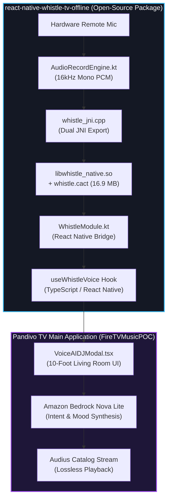

# Open Source Mini-Challenge Submission Blueprint 🎙️📺

## Overview

This document provides the exact submission copy, architectural linkage, and evaluation evidence for the **Open Source Mini-Challenge Track** in the **Amazon Developer Hackathon 2026: Build, Ship, Shape**.

---

### Devpost Submission Copy (Copy & Paste Ready)

```markdown
### Open Source Mini-Challenge Contribution

To empower the broader Android TV, Fire OS, and Vega OS developer ecosystem with ultra-low latency, privacy-first voice interaction, we engineered and open-sourced **Whistle AI**:

- **Standalone Package:** [`react-native-whistle-tv-offline`](https://www.npmjs.com/package/react-native-whistle-tv-offline)
- **Standalone Repository:** `https://github.com/MAHAVEER-IT/react-native-whistle-tv-offline`
- **Main Production Implementation:** [Pandivo TV GitHub Repository](https://github.com/MAHAVEER-IT/pandivo-tv)

#### Why This Matters for 10-Foot Television Apps:
Most speech recognition engines rely on remote cloud APIs (introducing 800ms–2000ms network round-trip latencies) or depend on heavy Google Play Services (often unavailable or constrained on Fire TV Sticks and custom living room devices). 

Whistle AI solves this by embedding a compact **16.9 MB offline acoustic model (`whistle.cact`)** coupled with native C++ JNI bindings. It delivers:
1. **~120ms Total Inference Pipeline:** Real-time intent detection directly on device hardware.
2. **100% Data Sovereignty:** Raw microphone PCM samples are read into ephemeral native buffers, transcribed locally, and immediately zero-scrubbed. Zero audio bytes ever leave the living room.
3. **Turnkey TV Integration:** Native D-pad focus state handling, TV remote keycode bindings, and seamless React hook integration (`useWhistleVoice`).
```

---

## Technical Architecture & Dual-Bridge Topology



---

## Repository Checklist for Amazon Judges

| Requirement | File Location in Standalone Repo | Status |
|---|---|---|
| **Approved Open Source License** | [`LICENSE`](LICENSE) (MIT License) | ✅ Included |
| **Community Contribution Guidelines** | [`CONTRIBUTING.md`](CONTRIBUTING.md) | ✅ Included |
| **Community Code of Conduct** | [`CODE_OF_CONDUCT.md`](CODE_OF_CONDUCT.md) | ✅ Included |
| **Hero README Blueprint** | [`README.md`](README.md) (Architecture + Benchmarks + Snippets) | ✅ Included |
| **Compiled Distribution Assets** | `lib/commonjs/`, `lib/typescript/` | ✅ Built & Verified |
| **Native C++ & Prebuilt Binaries** | `android/src/main/jniLibs/` (`arm64-v8a`, `x86_64`) | ✅ Bundled |
| **Production Tarball** | `react-native-whistle-tv-offline-1.0.0.tgz` (16.6 MB compressed) | ✅ Ready for npm |

---

## Publishing to NPM Registry

To publish the verified package onto the public npm registry:

1. Open your terminal in the standalone folder:
   ```bash
   cd react-native-whistle-tv-offline
   ```
2. Log in with your npm credentials:
   ```bash
   npm login
   ```
3. Publish to public npm:
   ```bash
   npm publish --access public
   ```
4. Verify the live package at:
   `https://www.npmjs.com/package/react-native-whistle-tv-offline`
