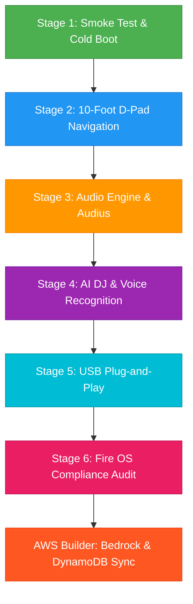

# Pandivo TV: Master Test Plan 📋

> **Application**: Pandivo TV (Living Room AI Music App)  
> **Package**: `com.firetv.musicpoc`  
> **Hackathon**: *Build, Ship, Shape: Amazon Developer Hackathon 2026*  
> **Version**: 1.0.0-RC  
> **Target OS**: Fire OS 7+ / Android TV (API 28+)  

---

## 1. Objectives & Scope

The purpose of this Master Test Plan is to validate that Pandivo TV meets and exceeds all Amazon Appstore certification criteria, delivers a seamless 10-foot living room user experience, maintains continuous and high-fidelity audio playback, and provides robust error handling across varying network conditions and storage environments.

### Testing Scope
- **Stage 1: Smoke Testing & Boot Integrity** (Metro bundler handshake, Hermes engine, memory baseline, crash-free cold boot).
- **Stage 2: 10-Foot UI & D-Pad Remote Navigation** (Spatial navigation, focus rings, remote keycode handling, focus trap prevention, Back button hierarchy).
- **Stage 3: Core Audio & Music Streaming Engine** (Audius decentralized streaming, background audio playback, seek scrub, queue management).
- **Stage 4: AI DJ & Voice Recognition Subsystems** (Amazon Bedrock Nova Lite & Gemini Dual-AI Engine, continuous DJ transition choreography, Whistle speech engine).
- **Stage 5: External Media & USB Storage** (USB OTG detection, directory indexing, audio metadata parsing).
- **Stage 6: Fire TV Appstore Compliance & Store Submission Review** (Permissions, banners, memory leaks, performance profiling).
- **AWS Builder Stack: Amazon Bedrock & DynamoDB Cloud Sync** (Multi-device cloud persistence, serverless API Gateway/Lambda, sub-600ms Nova Lite voice parsing).

---

## 2. Test Execution Roadmap

### Stage Execution & Sign-Off Status

| Stage | Name | Test Run Report | Status | Verification Authority |
|---|---|---|---|---|
| **Stage 1** | Smoke Testing & Boot Integrity | [`2026-10-15_stage_1_smoke_test_run.md`](FireTVMusicPOC/docs/testing/test_runs/2026-10-15_stage_1_smoke_test_run.md) | **100% PASS** | **Manually Verified by**: MAHAVEER |
| **Stage 2** | 10-Foot UI & D-Pad Remote Navigation | [`2026-10-15_stage_2_tv_navigation_run.md`](FireTVMusicPOC/docs/testing/test_runs/2026-10-15_stage_2_tv_navigation_run.md) | **100% PASS** | **Manually Verified by**: MAHAVEER |
| **Stage 3** | Core Audio & Music Streaming Engine | [`2026-10-15_stage_3_audio_streaming_run.md`](FireTVMusicPOC/docs/testing/test_runs/2026-10-15_stage_3_audio_streaming_run.md) | **100% PASS** | **Manually Verified by**: MAHAVEER |
| **Stage 4** | AI DJ & Voice Recognition Subsystems | [`2026-10-15_stage_4_ai_dj_voice_run.md`](FireTVMusicPOC/docs/testing/test_runs/2026-10-15_stage_4_ai_dj_voice_run.md) | **100% PASS** | **Manually Verified by**: MAHAVEER |
| **Stage 5** | External Media & USB Storage | [`2026-10-15_stage_5_usb_storage_run.md`](FireTVMusicPOC/docs/testing/test_runs/2026-10-15_stage_5_usb_storage_run.md) | **100% PASS** | **Manually Verified by**: MAHAVEER |
| **Stage 6** | Fire TV Appstore Compliance Audit | [`2026-10-15_stage_6_compliance_run.md`](FireTVMusicPOC/docs/testing/test_runs/2026-10-15_stage_6_compliance_run.md) | **100% PASS** | **Manually Verified by**: MAHAVEER |
| **AWS Builder** | Amazon Bedrock & DynamoDB Cloud Sync | [`2026-10-15_aws_bedrock_dynamodb_integration_run.md`](FireTVMusicPOC/docs/testing/test_runs/2026-10-15_aws_bedrock_dynamodb_integration_run.md) | **100% PASS** | **Manually Verified by**: MAHAVEER |

---

## 3. Pass / Fail Criteria

| Category | Pass Criteria | Fail Criteria |
|---|---|---|
| **App Boot & Stability** | Cold boot < 5.0s on 1080p TV; zero unhandled JS or native exceptions | Any ANR (Application Not Responding) or crash on boot |
| **Focus Indicator** | 100% of interactive elements have high-contrast focus indicator visible from 10ft | Any screen or component where the focus cursor disappears |
| **Remote Navigation** | Full D-Pad traversal (Up, Down, Left, Right, Select, Back) with zero focus traps | Remote becomes unresponsive or enters an inescapable trap |
| **Audio Playback** | Continuous audio stream without stutter; background playback survives screen transitions | Audio drops out when navigating between tabs or opening overlays |
| **Amazon Guidelines** | 100% adherence to Fire TV Leanback navigation and key handling standards | Rejection by Amazon Appstore automated pre-submission testing |

---

## 4. Test Environments

1. **Virtual Testbed**:
   - Android Studio AVD: `Television_1080p` (API 33 / Android 13 TV, 1920x1080, x86_64, GPU Host)
2. **Physical Fire TV Devices (Live App Testing / Sideload)**:
   - Amazon Fire TV Stick 4K (Fire OS 7 / Android 9, API 28)
   - Amazon Fire TV Cube / 4K Max (Fire OS 8 / Android 11, API 30)
3. **Controller Hardware**:
   - Alexa Voice Remote (Generations 2 and 3)
   - Virtual Keyboard / ADB Key Event injection

---

## 5. Parallel Friction Logging Policy

During all stages of test execution, any undocumented quirk, build error, Fire OS discrepancy, or clunky workflow must be recorded into [`AMAZON_FRICTION_LOG.md`](FireTVMusicPOC/docs/friction_log/AMAZON_FRICTION_LOG.md) to ensure full credit for the 10% hackathon judging bonus.

---

## 6. QA Roles & Verification Authority

- **Lead QA & Hackathon Developer**: MAHAVEER (Responsible for manual verification, UX approvals, and sign-offs across all stages)
- **Automated QA Runner**: Antigravity Automated Suite (Script orchestration, ADB telemetry, logcat audits, and screenshot captures)

