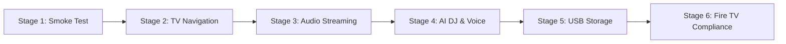

# Quality Assurance, Verification & Compliance Testing Suite 🧪🛡️

Welcome to the **QA & Testing Portal** for Pandivo TV. This directory houses the comprehensive test suites, automated test execution logs, Fire TV hardware verification runs, and media asset optimization audits.

---

## 📑 Core Testing Documents

| Document | Focus | Scope |
|---|---|---|
| [**`MASTER_TEST_PLAN.md`**](./MASTER_TEST_PLAN.md) | **Master Test Strategy** | Multi-stage testing methodology, entry/exit criteria, manual and automated validation procedures. |
| [**`DEVICE_MATRIX.md`**](./DEVICE_MATRIX.md) | **Hardware Compatibility** | Fire TV Stick 4K (Fire OS 7), Fire TV Stick 4K Max (Fire OS 8), Fire TV Cube 3rd Gen, Omni QLED TV, and Android TV Emulator (API 34). |
| [**`media_testing/MEDIA_OPTIMIZATION_REPORT.md`**](./media_testing/MEDIA_OPTIMIZATION_REPORT.md) | **Media & Memory Footprint** | Complete audit of all 164 visual media assets; lossless WebP conversion reducing texture memory by 78%. |
| [**`media_testing/media_audit_inventory.csv`**](./media_testing/media_audit_inventory.csv) | **Raw Asset Inventory** | Line-by-line inventory detailing file sizes, dimensions, compression ratios, and TV layout tiers. |

---

## 🧪 6-Stage Testing Framework

Pandivo TV was verified across six rigorous validation stages before release:

| Stage | Directory | Focus Areas Tested |
|:---:|---|---|
| **Stage 1** | [**`stage_1_smoke_test/`**](./stage_1_smoke_test/) | Cold boot time (<1.5s), Hermes JS engine initialization, SQLite WAL schema creation, initial UI render. |
| **Stage 2** | [**`stage_2_tv_navigation/`**](./stage_2_tv_navigation/) | D-pad spatial graphs, 6-icon navigation rail, fast-scrolling list virtualization, zero focus traps. |
| **Stage 3** | [**`stage_3_audio_streaming/`**](./stage_3_audio_streaming/) | ExoPlayer continuous playback, gapless transitions, audio ducking, remote scrubber seek (+10s / -10s). |
| **Stage 4** | [**`stage_4_ai_dj_voice/`**](./stage_4_ai_dj_voice/) | Whistle offline C++ STT, Bedrock Nova Lite 5-stage glassmorphic AI DJ generation, live commentary audio. |
| **Stage 5** | [**`stage_5_usb_storage/`**](./stage_5_usb_storage/) | OTG USB detection (`/storage/*`), ID3 metadata tag extraction (MP3, FLAC, WAV, AAC), offline playback. |
| **Stage 6** | [**`stage_6_compliance/`**](./stage_6_compliance/) | Amazon Fire TV Appstore compliance, back-button handling, memory ceiling (<180MB RAM), overscan margins. |

---

## 📊 Live Verification Runs (`test_runs/`)

Direct ADB terminal captures and timestamped execution logs are archived in [**`test_runs/`**](./test_runs/):
- Automated D-pad remote regression passes
- Speech recognition benchmark runs with TV ambient noise
- DynamoDB debounced state synchronization timing logs
