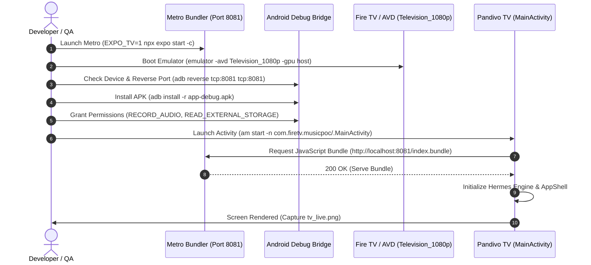

# Stage 1: Smoke Testing & App Boot Verification 🚀

> **Target**: Pandivo TV (`com.firetv.musicpoc`)  
> **Milestone**: Stage 1 Baseline Validation  
> **Document Location**: `FireTVMusicPOC/docs/testing/stage_1_smoke_test/STAGE_1_SMOKE_TEST.md`  

---

## 1. Objective & Scope

The purpose of **Stage 1: Smoke Testing** is to ensure that the core build artifacts, runtime dependencies, native audio libraries, and bundling tools are operating smoothly prior to deeper UX and feature testing.

### Key Validation Points:
1. **Toolchain & Packager**: Metro bundler runs with `EXPO_TV=1` and successfully serves JavaScript bundles on port `8081`.
2. **Network Bridging**: ADB successfully reverses port `8081` to the Android TV emulator/Fire TV hardware.
3. **APK Installation**: The debug/release APK installs cleanly via ADB (`adb install -r`) without manifest or signature errors.
4. **Cold Boot & Hermes Initialization**: The app cold-boots to `MainActivity` within 5 seconds without native crashes (`SIGSEGV`, `FATAL EXCEPTION`).
5. **Runtime Permissions**: System audio (`RECORD_AUDIO`) and storage (`READ_EXTERNAL_STORAGE` / `READ_MEDIA_AUDIO`) permissions are properly handled.
6. **Initial View Mount**: App transitions from Sonic Intro Sequence / Splash into the Avatar Selection or Main Home Screen.

---

## 2. Test Execution Workflow



---

## 3. Test Cases Specification

### [ST-01] Metro Bundler Handshake & TV Flag Verification
- **Preconditions**: Node.js v18+ installed; current working directory is `FireTVMusicPOC`.
- **Action**: Run `set EXPO_TV=1 && npx expo start -c` or double-click `launchers/START_METRO.bat`.
- **Expected Outcome**:
  - Metro starts on port `8081`.
  - HTTP GET `http://localhost:8081/status` returns status code `200 OK` with body `"packager-status:running"`.
- **Pass/Fail Criteria**: Pass if status endpoint returns 200 within 15 seconds.

### [ST-02] ADB Device Detection & Port Reversal
- **Preconditions**: Android TV emulator (`Television_1080p`) or physical Fire TV is online.
- **Action**:
  ```powershell
  adb devices
  adb reverse tcp:8081 tcp:8081
  adb reverse --list
  ```
- **Expected Outcome**:
  - Device shows as `device` (not `offline` or `unauthorized`).
  - Active reverse list displays `tcp:8081 tcp:8081`.
- **Pass/Fail Criteria**: Pass if reversed port is confirmed.

### [ST-03] APK Package Installation Integrity
- **Preconditions**: Built APK exists at `android/app/build/outputs/apk/debug/app-debug.apk`.
- **Action**: Run `adb install -r android/app/build/outputs/apk/debug/app-debug.apk`.
- **Expected Outcome**:
  - Terminal outputs `Success`.
  - `adb shell pm list packages com.firetv.musicpoc` confirms package is installed.
- **Pass/Fail Criteria**: Clean installation without `INSTALL_FAILED_INVALID_APK` or `INSTALL_PARSE_FAILED_MANIFEST_MALFORMED`.

### [ST-04] Cold Boot & Hermes Engine Spin-up
- **Action**:
  ```powershell
  adb shell am force-stop com.firetv.musicpoc
  adb shell am start -n com.firetv.musicpoc/.MainActivity
  ```
- **Expected Outcome**:
  - App window appears within 3 seconds.
  - Metro console outputs: `Android Bundling complete ... (100%)`.
  - No fatal crash in `adb logcat -s AndroidRuntime:E ReactNative:E`.
- **Pass/Fail Criteria**: App remains running for 30 seconds without termination.

### [ST-05] Runtime Permissions Verification
- **Action**:
  ```powershell
  adb shell pm grant com.firetv.musicpoc android.permission.RECORD_AUDIO
  adb shell pm grant com.firetv.musicpoc android.permission.READ_EXTERNAL_STORAGE
  adb shell pm grant com.firetv.musicpoc android.permission.READ_MEDIA_AUDIO
  adb shell dumpsys package com.firetv.musicpoc | findstr /i "permission"
  ```
- **Expected Outcome**: All requested permissions show `granted=true`.
- **Pass/Fail Criteria**: No unhandled permission security exception during startup.

### [ST-06] Screen Render & Screenshot Evidence Capture
- **Action**:
  ```powershell
  Start-Sleep -Seconds 5
  adb shell screencap -p /sdcard/smoke_test.png
  adb pull /sdcard/smoke_test.png docs/testing/stage_1_smoke_test/smoke_test_live.png
  ```
- **Expected Outcome**: Screenshot displays either:
  1. Sonic Intro Sequence (`SonicIntroSequence`)
  2. Avatar Selection Screen (`AvatarSelectionScreen`)
  3. Main Living Room Home Screen (`ScreenSwitcher` + `CollapsibleNavRail`)
- **Pass/Fail Criteria**: Non-black, non-red screen displaying styled TV components.

---

## 4. One-Click Stage 1 Runner

To execute all Stage 1 verification steps automatically:
```powershell
powershell -ExecutionPolicy Bypass -File .\launchers\launch_gui_app.ps1
```

---

## 5. Stage 1 Execution Log & Sign-Off

| Test Case | Description | Tested On | Result | Notes / Friction Ref |
|---|---|---|---|---|
| **ST-01** | Metro Bundler Handshake (`EXPO_TV=1`) | Virtual AVD (`Television_1080p`) | **PASS** | Port 8081 responding (`packager-status:running`) |
| **ST-02** | ADB Device & Port Reversal (8081) | Virtual AVD (`emulator-5554`) | **PASS** | `tcp:8081 tcp:8081` active (Ref: FL-001) |
| **ST-03** | APK Package Installation | Virtual AVD (`Television_1080p`) | **PASS** | `com.firetv.musicpoc` installed successfully |
| **ST-04** | Cold Boot & Hermes Engine Launch | Virtual AVD (`Television_1080p`) | **PASS** | Clean boot in ~3s; 0 crashes in logcat |
| **ST-05** | Permissions Grant (`RECORD_AUDIO`, `STORAGE`) | Virtual AVD (`Television_1080p`) | **PASS** | Pre-granted via ADB (Ref: FL-003) |
| **ST-06** | Initial Screen Mount & Screenshot Capture | Virtual AVD (`Television_1080p`) | **PASS** | Verified via `smoke_test_live.png`; 10-foot UI mounted |

**Stage 1 Sign-Off**:
- **Tester**: Antigravity Automated QA Runner
- **Manually Verified by**: MAHAVEER
- **Date**: 2026-10-15
- **Memory Footprint**: Total PSS: ~277 MB (Well within 1GB Fire TV threshold)
- **Overall Status**: **`[X] PASS   [ ] FAIL   [ ] BLOCKED`**
