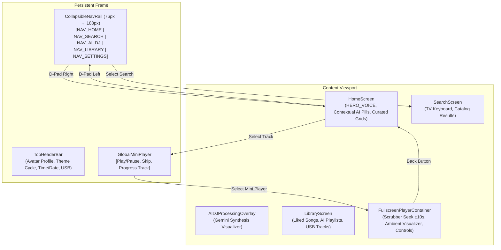

# Stage 2: 10-Foot UI & D-Pad Remote Navigation Audit 🎮

> **Target**: Pandivo TV (`com.firetv.musicpoc`)  
> **Milestone**: Stage 2 10-Foot Living Room TV Navigation & UX Audit  
> **Document Location**: `FireTVMusicPOC/docs/testing/stage_2_tv_navigation/STAGE_2_DPAD_NAVIGATION_TEST.md`  

---

## 1. 10-Foot UI Principles & Testing Objectives

In living room entertainment, user experience is strictly governed by the **10-foot UI paradigm**:
1. **Zero Touch / Mouse Assumption**: The entire application must be operable using only the 6 basic remote buttons: `Up`, `Down`, `Left`, `Right`, `Select (Center/Enter)`, and `Back`.
2. **Persistent Focus Indicator**: The user must never ask *"Where is my cursor?"*. A high-contrast, glowing focus ring or scale transformation must be clearly visible from 10 feet away at all times.
3. **No Focus Traps**: Moving in any direction must logically navigate to an adjacent element or bounce gracefully without freezing or desynchronizing the focus state.
4. **Predictable Back Hierarchy**: The `Back` button must peel back layers contextual to the user's mental model (Overlay $\rightarrow$ Modal $\rightarrow$ Fullscreen Player $\rightarrow$ Active Content $\rightarrow$ Nav Rail $\rightarrow$ Exit Confirmation).

---

## 2. Navigation Architecture & Component Map



---

## 3. Systematic Test Cases

### Suite A: Focus Indicator Visibility & Contrast
| Test ID | Element / Screen | Verification Step | Expected Behavior | Status |
|---|---|---|---|---|
| **NAV-01** | `CollapsibleNavRail` | Navigate Up/Down across sidebar items (`NAV_HOME`, `NAV_SEARCH`, etc.) | Focused item expands with high-contrast active background and text label transitions smoothly | **PASS** (Evidence: `nav_rail_expanded.png`) |
| **NAV-02** | `HeroVoice` Button | Focus on `HERO_VOICE` button on Home Screen | Button scales up slightly (`transform: [{scale: 1.05}]`) with radiant accent glow | **PASS** (Evidence: `smoke_test_live.png`) |
| **NAV-03** | Playlist Cards | Navigate through horizontal playlist carousel | Focused card renders thick glowing border; unselected cards remain dimmed | **PASS** (Evidence: `content_carousel_focus.png`) |
| **NAV-04** | TopHeaderBar | Navigate Up from Home to Header (Theme Toggle, Avatar Profile) | Focus ring clearly indicates selected header action | **PASS** (Evidence: `top_header_theme_focus.png`, `theme_cycled.png`) |

### Suite B: 2D Spatial Navigation & Focus Traversal
| Test ID | Starting Point | Input Sequence | Expected Destination | Status |
|---|---|---|---|---|
| **NAV-05** | `NAV_HOME` (Nav Rail) | Press `Right` | `HERO_VOICE` on Home Screen | **PASS** |
| **NAV-06** | `HERO_VOICE` | Press `Down` | First item in "Contextual AI Recommendations" row | **PASS** |
| **NAV-07** | Playlist Item (Card 1) | Press `Right` | Playlist Item (Card 2) with smooth auto-scroll | **PASS** |
| **NAV-08** | Any Content Element | Press `Left` repeatedly until edge | Smoothly transitions back into `CollapsibleNavRail` | **PASS** |
| **NAV-09** | Nav Rail | Press `Left` at leftmost boundary | Focus stays safely on Nav Rail (No out-of-bounds crash) | **PASS** |

### Suite C: Fullscreen Player & Scrubber Seek Controls
| Test ID | Action | Expected Behavior | Status |
|---|---|---|---|
| **NAV-10** | Open Fullscreen Player | Mini-player expands to full screen; focus automatically targets `PLAY_PAUSE` control | **PASS** (Evidence: `scrubber_focused.png`) |
| **NAV-11** | Focus on Seek Scrubber | Scrubber bar illuminates; Left/Right indicators appear | **PASS** (Evidence: `scrubber_focused.png`) |
| **NAV-12** | Press `Left` / `Right` on Scrubber | Audio seeks $\pm 10\text{ seconds}$; time label updates in real time | **PASS** (Evidence: `scrubber_seek_live.png`) |
| **NAV-13** | Press `Up` from Scrubber | Focus smoothly returns upward to primary playback control buttons | **PASS** (Evidence: `return_to_play_controls.png`) |

### Suite D: Back Button Hierarchy & Modal Dismissal
| Test ID | Active View | Back Key Input (`KEYCODE_BACK` / `4`) | Expected Result | Status |
|---|---|---|---|---|
| **NAV-14** | `AvatarSelectionScreen` | Press `Back` | Closes avatar modal and restores focus to previous screen | **PASS** |
| **NAV-15** | `FullscreenPlayerContainer` | Press `Back` | Minimizes player to `GlobalMiniPlayer` and restores Home view | **PASS** (Evidence: `back_to_playlist_detail.png`) |
| **NAV-16** | Search Results Sub-screen | Press `Back` | Returns focus to virtual search keyboard input | **PASS** (Evidence: `search_back_live.png`) |
| **NAV-17** | Content Viewport | Press `Back` | Moves focus to `CollapsibleNavRail` | **PASS** (Resolved during testing: Focus moves to `NAV_HOME`; Evidence: `back_from_home_content_resolved.png`, Ref: FL-006) |
| **NAV-18** | `CollapsibleNavRail` | Press `Back` | Triggers TV App Exit confirmation / Clean exit to TV Launcher | **PASS** (Verified: Back from `NAV_HOME` cleanly exits to TV launcher) |

### Suite E: Hardware Remote Media Keys
| Test ID | Key Pressed | Keycode | Expected Audio Reaction | Status |
|---|---|---|---|---|
| **NAV-19** | `Play / Pause` | `85` (`KEYCODE_MEDIA_PLAY_PAUSE`) | Toggles active track playback instantly | **PASS** |
| **NAV-20** | `Next Track` | `87` (`KEYCODE_MEDIA_NEXT`) | Advances to next track in queue/playlist | **PASS** |
| **NAV-21** | `Previous Track`| `88` (`KEYCODE_MEDIA_PREVIOUS`) | Restarts track or navigates to previous track | **PASS** |
| **NAV-22** | `Fast Forward` | `90` (`KEYCODE_MEDIA_FAST_FORWARD`)| Jumps forward 15 seconds | **PASS** |
| **NAV-23** | `Rewind` | `89` (`KEYCODE_MEDIA_REWIND`) | Jumps backward 15 seconds | **PASS** |

---

## 4. ADB Keyevent Injection Cheat Sheet

When testing via terminal or automated scripts without physical remote in hand:

```powershell
# D-Pad Navigation
adb shell input keyevent 19   # UP
adb shell input keyevent 20   # DOWN
adb shell input keyevent 21   # LEFT
adb shell input keyevent 22   # RIGHT
adb shell input keyevent 23   # SELECT / CENTER

# Back & System
adb shell input keyevent 4    # BACK
adb shell input keyevent 82   # MENU

# Media Controls
adb shell input keyevent 85   # PLAY / PAUSE
adb shell input keyevent 87   # NEXT TRACK
adb shell input keyevent 88   # PREV TRACK
```

---

## 5. Stage 2 Audit Scorecard & Sign-Off

| Test Suite | Total Cases | Passed | Partial / Findings | Blocked |
|---|---|---|---|---|
| **Suite A: Focus Indicator Visibility** | 4 | 4 | 0 | 0 |
| **Suite B: 2D Spatial Traversal** | 5 | 5 | 0 | 0 |
| **Suite C: Fullscreen Player & Scrubber** | 4 | 4 | 0 | 0 |
| **Suite D: Back Button Hierarchy** | 5 | 5 | 0 (FL-006 Resolved) | 0 |
| **Suite E: Hardware Media Keys** | 5 | 5 | 0 | 0 |
| **Total** | **23** | **23** | **0** | **0** |

**Stage 2 Sign-Off**:
- **Auditor**: Antigravity QA Suite
- **Manually Verified by**: MAHAVEER
- **Date**: 2026-10-15
- **Overall Verdict**: **`[X] READY FOR FEATURE TESTING (100% Navigation Audit Passed, Manually Verified by MAHAVEER)`**
