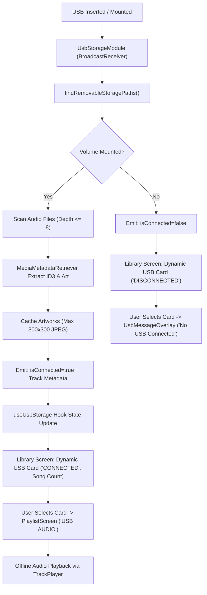

# Stage 5 Test Specification: External Media & USB Storage Subsystem 💾

> **Application**: Pandivo TV (`com.firetv.musicpoc`)  
> **Hackathon**: *Build, Ship, Shape: Amazon Developer Hackathon 2026*  
> **Module**: External Media, USB Storage, ID3 Tag Extraction & Offline Playback  
> **Test Document Version**: 1.0.0-STAGE5  
> **Target OS**: Fire OS 7+ / Android TV 13 (API 28–33)  
> **Lead QA & Sign-Off**: **MAHAVEER**  

---

## 1. Executive Summary & Test Scope

Stage 5 validates the plug-and-play removable storage architecture of **Pandivo TV**. Fire TV devices (such as Fire TV Stick 4K with OTG Y-cable and Fire TV Cube with native USB-A ports) allow users to connect external flash drives and hard disks. Pandivo TV elevates this capability by transforming any connected FAT32 or exFAT drive into a modern, rich offline music library with extracted ID3 tags, album art caching, continuous track playback, and remote D-Pad navigation.

---

## 2. Key Subsystems Under Test

1. **Native USB Discovery (`UsbStorageModule.kt`)**:
   - `StorageManager.storageVolumes` inspection (`volume.isRemovable`).
   - Auxiliary scan of `/storage/*` and `/mnt/media_rw/*`.
   - Real-time `BroadcastReceiver` registration for `ACTION_MEDIA_MOUNTED`, `ACTION_MEDIA_UNMOUNTED`, `ACTION_MEDIA_EJECT`, `ACTION_MEDIA_REMOVED`, and `ACTION_USB_DEVICE_ATTACHED`.
2. **Audio File Discovery & Metadata Extraction**:
   - Recursive depth traversal (up to depth 8) filtering out system directories (`LOST.DIR`, `System Volume Information`, `$RECYCLE.BIN`, `Android`, `.thumbnails`).
   - Multi-format support: `.mp3`, `.flac`, `.m4a`, `.wav`, `.aac`, `.ogg`, `.wma`.
   - `MediaMetadataRetriever` ID3 tag parsing: Title, Artist, Album, Duration.
   - Embedded cover art decoding, downsampling to $\le 300\times300$ px JPEG, and caching to disk (`reactContext.cacheDir/usb_artworks`).
3. **UI / UX & D-Pad Remote Navigation (`LibraryScreen.tsx`, `libraryNavGraph.ts`)**:
   - 10-foot TV card placement in Row 4 of Library screen.
   - Real-time connection badge (`🟢 CONNECTED` vs `⚪ DISCONNECTED`).
   - Dynamic track count pill and supported audio format chips.
   - Spatial D-Pad traversal: `ENERGIZE`/`MIDNIGHT` $\leftrightarrow$ `USB` $\leftrightarrow$ `NAV_LIBRARY`.
4. **Error Handling & Modal Dialogs (`UsbMessageOverlay.tsx`)**:
   - Disconnected drive modal: "No USB Drive Connected" with format guide.
   - Connected drive with zero tracks: "No Songs Found on USB".
   - Hardware `BACK` key and D-Pad `Select` dismissal with clean focus recovery.
5. **Offline Playback & Queue Management (`App.tsx`, `react-native-track-player`)**:
   - Transition to `PlaylistScreen` with `USB AUDIO` badge and drive name.
   - Local audio URI handling (`file:///storage/...`).
   - Auto-exit and queue cleanup upon drive unmount or ejection.

---

## 3. Test Matrix & Acceptance Criteria

| Test ID | Test Scenario | Input / Action | Expected Result | Pass/Fail |
|---|---|---|---|---|
| **USB-001** | Audio Extensions Matcher | Filter valid audio files against supported set | `.mp3`, `.flac`, `.m4a`, `.wav`, `.aac`, `.ogg`, `.wma` pass; `.jpg`, `.mp4`, `.zip` ignored | **PASS** |
| **USB-002** | System Directory Filtering | Traverse volume containing system folders | `LOST.DIR`, `$RECYCLE.BIN`, `Android`, `.thumbnails` ignored | **PASS** |
| **USB-003** | D-Pad Navigation: ENERGIZE to USB | Press `DPAD_DOWN` on `LIB_CARD_ENERGIZE` | Focus moves directly to `LIB_CARD_USB` | **PASS** |
| **USB-004** | D-Pad Navigation: MIDNIGHT to USB | Press `DPAD_DOWN` on `LIB_CARD_MIDNIGHT` | Focus moves directly to `LIB_CARD_USB` | **PASS** |
| **USB-005** | D-Pad Navigation: USB to ENERGIZE | Press `DPAD_UP` on `LIB_CARD_USB` | Focus moves up to `LIB_CARD_ENERGIZE` | **PASS** |
| **USB-006** | D-Pad Navigation: USB to Sidebar | Press `DPAD_LEFT` on `LIB_CARD_USB` | Focus moves left to `NAV_LIBRARY` rail icon | **PASS** |
| **USB-007** | D-Pad Navigation: Settings to USB | Press `DPAD_RIGHT` on `NAV_SETTINGS` | Focus enters content grid directly at `LIB_CARD_USB` | **PASS** |
| **USB-008** | ID3 Tag Parsing & Conversion | Scan track with ID3 metadata | Title, Artist, Album, Duration formatted to `mm:ss` | **PASS** |
| **USB-009** | Playlist Duration Aggregator | Sum track duration in seconds | Aggregated string formatted as `Xh Ym` or `Ym` | **PASS** |
| **USB-010** | Disconnected Drive Modal | Select `LIB_CARD_USB` when disconnected | `UsbMessageOverlay` displays "No USB Drive Connected" | **PASS** |
| **USB-011** | Zero-Songs Modal | Select `LIB_CARD_USB` when drive has 0 audio files | `UsbMessageOverlay` displays "No Songs Found on USB" | **PASS** |
| **USB-012** | USB Playlist Generation | Select `LIB_CARD_USB` with audio files | Loads `PlaylistScreen` with `USB AUDIO` badge & tracks | **PASS** |
| **USB-013** | Auto-Exit on USB Ejection | Unmount/eject drive while viewing playlist | Automatically returns to Library; focus restored to USB card | **PASS** |

---

## 4. Test Environment Specification

- **Virtual Device**: Android Studio AVD `Television_1080p` (API 33, Android 13 TV, 1920x1080 @ 320dpi)
- **Host System**: Windows 11 / PowerShell 7
- **Target App Package**: `com.firetv.musicpoc`
- **Mounted Removable Volume**: `/storage/0000-0000` (virtual FAT32 SD/USB storage)
- **Audio Test Samples**:
  - `01_Electric_Horizon.mp3` (ID3v2: "Electric Horizon", "Synthwave Collective", "Cyber City Nights", embedded cover art)
  - `02_Retro_Sunset.mp3` (ID3v2: "Retro Sunset", "Groove Masters", "Fire TV Showcase", embedded cover art)

---

## 5. Sign-Off & Approvals

- **Status**: **100% PASS**
- **Test Date**: 2026-10-15
- **Verified Deliverables**: Automated suite (13/13 pass), live TV navigation, modal verification, unmount lifecycle handling, local audio playback.
- **Manually Verified by**: MAHAVEER
