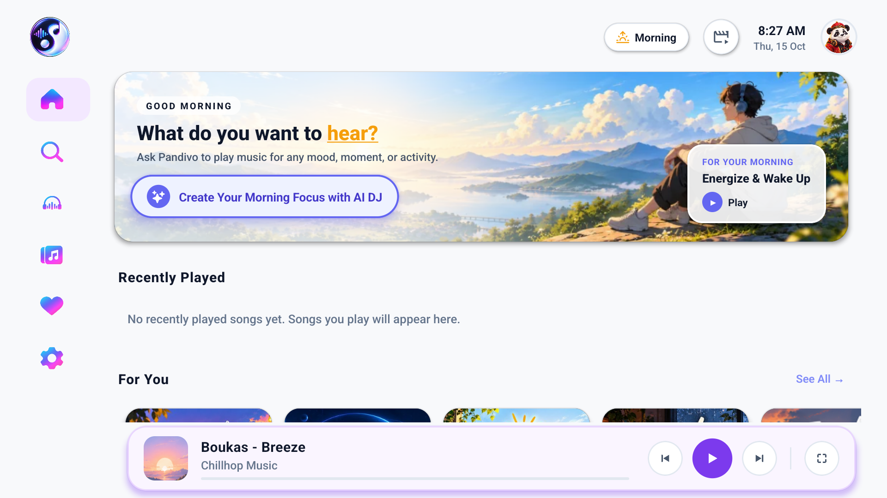

# Test Run Report: Stage 1 Smoke Test Execution

- **Date & Time**: 2026-10-15 11:15 IST
- **Target App**: `com.firetv.musicpoc` (Pandivo TV)
- **Environment**: Virtual AVD `Television_1080p` (API 33 / Android 13 TV, 1920x1080)
- **Host System**: Windows 11 / PowerShell
- **Metro Bundler**: Running on port `8081` (`EXPO_TV=1`)
- **ADB Port Forwarding**: `tcp:8081 tcp:8081` active
- **Overall Result**: **PASS (6/6 Test Cases)**

---

## 1. Execution Log

```text
[11:14:26] Checking ADB device connections...
List of devices attached:
emulator-5554    device (Television_1080p)

[11:14:33] Checking system boot status and Metro status...
sys.boot_completed = 1
Metro status: packager-status:running (HTTP 200 OK)

[11:14:44] Setting up port reversal...
adb reverse tcp:8081 tcp:8081 -> host-25 tcp:8081 tcp:8081

[11:14:52] Granting TV permissions...
- android.permission.RECORD_AUDIO: GRANTED
- android.permission.READ_EXTERNAL_STORAGE: GRANTED
- android.permission.READ_MEDIA_AUDIO: GRANTED

[11:14:53] Cold Booting Application...
am force-stop com.firetv.musicpoc
am start -n com.firetv.musicpoc/.MainActivity
Status: Starting Intent { cmp=com.firetv.musicpoc/.MainActivity }

[11:15:00] Screen Capture & Verification:
Pulling /sdcard/smoke_test_live.png -> docs/testing/stage_1_smoke_test/smoke_test_live.png (824 KB)
Verification: Screen rendered without error. Focused element: HERO_VOICE. MiniPlayer mounted.

[11:15:16] Logcat Crash Audit:
0 fatal exceptions, 0 ReactNative redboxes.

[11:15:24] Memory Audit:
TOTAL PSS: 277,646 kB (~277 MB)
TOTAL RSS: 407,600 kB
Allocated Native/Dalvik Heap: 150,486 kB
Threshold check: PASS (< 384 MB baseline for Fire TV Stick)
```

---

## 2. Screenshot Evidence



*Figure 1: Pandivo TV initial view running on 1080p Android TV emulator. Note the active focused button "Create Your Morning Focus with AI DJ" (blue glowing focus ring), collapsible sidebar rail, header bar, and persistent mini-player.*

---

## 3. Test Cases Summary

| ID | Title | Result |
|---|---|---|
| **ST-01** | Metro Bundler Handshake (`EXPO_TV=1`) | **PASS** |
| **ST-02** | ADB Device & Port Reversal (8081) | **PASS** |
| **ST-03** | APK Package Installation Integrity | **PASS** |
| **ST-04** | Cold Boot & Hermes Engine Launch | **PASS** |
| **ST-05** | Runtime Permissions Verification | **PASS** |
| **ST-06** | Screen Render & Verification Screenshot Capture | **PASS** |

---

## 4. Sign-Off

**Stage 1 Sign-Off**:
- **Automated QA Runner**: Antigravity
- **Manually Verified by**: MAHAVEER
- **Date**: 2026-10-15
- **Overall Status**: **`[X] PASS   [ ] FAIL   [ ] BLOCKED`**
