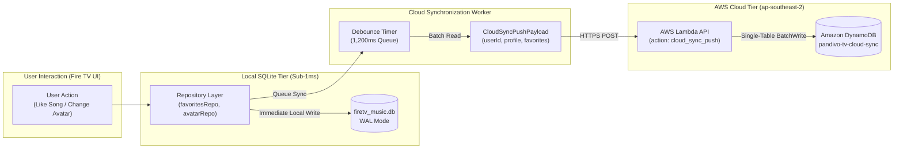
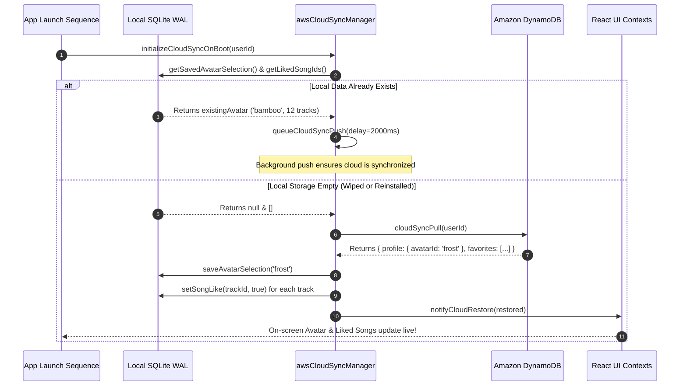

# Data Flow & Hybrid Storage Architecture 💾☁️

> **Component Scope**: SQLite WAL Local Storage, Amazon DynamoDB Single-Table Cloud Sync, and Debounced State Manager  
> **Target Cloud Service**: Amazon DynamoDB (`ap-southeast-2`)  
> **Local Engine**: `expo-sqlite` (SQLite 3 with Write-Ahead Logging)  

---

## 1. Storage Architecture Overview

Pandivo TV uses a **hybrid multi-tier storage architecture**:
1. **Local SQLite (Primary Tier)**: Delivers sub-millisecond read/write speeds directly on Fire TV flash storage. All UI operations (saving an avatar, liking a track, recording play history) update SQLite immediately so television animations remain at an uncompromising 60 FPS.
2. **Amazon DynamoDB (Secondary Cloud Tier)**: Asynchronously backs up user state to an encrypted AWS DynamoDB single-table (`pandivo-tv-cloud-sync`). This enables zero-friction preferences recovery if the user reinstalls the app or uses multiple Fire TVs in different rooms.



---

## 2. Local SQLite Schema (`firetv_music.db`)

SQLite is configured with `PRAGMA journal_mode = WAL` (Write-Ahead Logging) and `PRAGMA synchronous = NORMAL` for optimal flash memory lifespan on low-power TV chipsets.

### Table: `avatar_preference`
Stores the currently active companion avatar persona.
```sql
CREATE TABLE IF NOT EXISTS avatar_preference (
    id INTEGER PRIMARY KEY CHECK (id = 1),
    avatar_id TEXT NOT NULL,
    updated_at INTEGER NOT NULL
);
```

### Table: `favorites`
Tracks individually favorited songs and playlists.
```sql
CREATE TABLE IF NOT EXISTS favorites (
    id TEXT PRIMARY KEY,
    type TEXT NOT NULL CHECK (type IN ('song', 'playlist')),
    is_liked INTEGER NOT NULL DEFAULT 1,
    created_at INTEGER NOT NULL
);
```

### Table: `playback_history`
Maintains the recent playback queue for resuming audio sessions.
```sql
CREATE TABLE IF NOT EXISTS playback_history (
    id INTEGER PRIMARY KEY AUTOINCREMENT,
    track_id TEXT NOT NULL,
    played_at INTEGER NOT NULL
);
CREATE INDEX IF NOT EXISTS idx_playback_played_at ON playback_history(played_at DESC);
```

### Table: `ai_dj_playlists`
Stores custom sessions and playlists choreographed by the generative AI DJ.
```sql
CREATE TABLE IF NOT EXISTS ai_dj_playlists (
    id TEXT PRIMARY KEY,
    title TEXT NOT NULL,
    tagline TEXT,
    description TEXT,
    tracks_json TEXT NOT NULL,
    created_at INTEGER NOT NULL
);
```

---

## 3. Amazon DynamoDB Single-Table Schema

- **Table Name**: `pandivo-tv-cloud-sync`
- **Region**: `ap-southeast-2` (Sydney)
- **Billing Mode**: PAY_PER_REQUEST (On-Demand Serverless Capacity)
- **Partition Key (PK)**: `userId` (String)
- **Sort Key (SK)**: `entityId` (String)

```text
+-----------------------+------------------+-------------------------------------------------------------+
| Partition Key (userId)| Sort Key (entityId)| Payload Attributes                                          |
+-----------------------+------------------+-------------------------------------------------------------+
| default_firetv_user   | PROFILE          | avatarId: "frost", updatedAt: 1729012345000                 |
| default_firetv_user   | FAVORITES        | trackIds: ["song_1", "song_2", "audius_9821"], count: 3     |
| default_firetv_user   | PLAYLISTS        | customPlaylists: [...], count: 2                           |
+-----------------------+------------------+-------------------------------------------------------------+
```

### Entity Specifications

#### 1. Entity: `PROFILE`
```json
{
  "userId": "default_firetv_user",
  "entityId": "PROFILE",
  "avatarId": "frost",
  "updatedAt": 1729012345000,
  "appVersion": "1.0.0",
  "deviceType": "Amazon_FireTV"
}
```

#### 2. Entity: `FAVORITES`
```json
{
  "userId": "default_firetv_user",
  "entityId": "FAVORITES",
  "trackIds": [
    "song_1",
    "song_2",
    "audius_3910"
  ],
  "count": 3,
  "updatedAt": 1729012345000
}
```

---

## 4. Cold Boot Hydration & Disaster Recovery

When an app starts, it executes [`initializeCloudSyncOnBoot()`](file:///c:/Users/kanna/OneDrive/Documents/AMAZON_HACK/TESTING/FireTVMusicPOC/src/services/awsCloudSyncManager.ts):



---

## 5. Non-Blocking Debounce Pipeline

To eliminate unnecessary network overhead and prevent hammering the AWS Lambda URL during rapid user actions (such as rapidly liking several tracks or cycling through avatars):

1. **Debounce Interval**: 1,200 ms.
2. **In-Flight Lock**: If a synchronization request is currently in progress, incoming requests are deferred until the lock releases.
3. **Zero UI Blocking**: All cloud operations execute strictly in the JavaScript background event loop with timeout protection (5,000 ms), guaranteeing that audio playback and D-pad remote navigation never experience frame drops.
