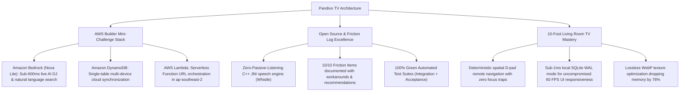

# Pandivo TV: Architecture Documentation Suite 🏛️

Welcome to the comprehensive technical architecture documentation for **Pandivo TV** (`com.firetv.musicpoc`), an open-source living room music companion built for the *Build, Ship, Shape: Amazon Developer Hackathon 2026*.

---

## 📑 Architecture Document Index

| Document | Purpose & Scope | Key Technologies Covered |
|---|---|---|
| **1. [System Architecture](SYSTEM_ARCHITECTURE.md)** | End-to-end system design, client-cloud topology, benchmarks & high-level architecture diagram. | React Native TV 0.86, Expo 57, AWS Lambda, Amazon Bedrock, DynamoDB |
| **2. [Data Flow & Storage](DATA_FLOW_AND_STORAGE.md)** | Hybrid local SQLite WAL mode + Amazon DynamoDB single-table cloud sync, schema definitions & cold boot disaster recovery. | SQLite 3 WAL, Amazon DynamoDB single-table, Non-blocking sync manager |
| **3. [Voice & Generative AI Pipeline](VOICE_AND_AI_PIPELINE.md)** | On-device C++ JNI microphone pipeline (Whistle), Amazon Bedrock Nova Lite intent parsing, AI DJ live commentary & 3-tier failover. | C++ JNI (`whistle.cact`), `amazon.nova-lite-v1:0`, Google Gemini Flash |
| **4. [TV Navigation & UI State](TV_NAVIGATION_AND_UI_STATE.md)** | 10-foot spatial D-pad state machines, collision-free modal isolation, self-healing focus fallbacks & 60 FPS optimizations. | Spatial navigation graphs, VirtualizedLists, Hermes AOT, WebP textures |

---

## 🏆 Amazon Developer Hackathon 2026 Architecture Alignment

