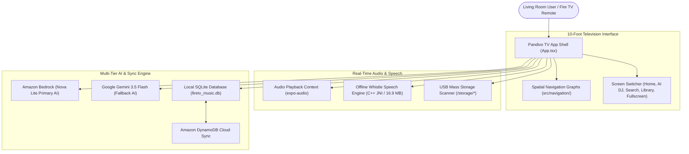

# Pandivo TV: Getting Started & Developer Setup Guide 🚀📺

Welcome to the **Pandivo TV** onboarding and developer documentation! This guide walks you step-by-step from cloning the GitHub repository to running the application on an Android TV emulator or physical Amazon Fire TV device.

---

## ⚡ 60-Second Quickstart (For Experienced Developers)

If your environment already has **Node.js LTS**, **JDK 17**, and the **Android TV SDK / ADB** configured:

```bash
# 1. Clone the repository
git clone https://github.com/MAHAVEER-IT/pandivo-tv.git
cd pandivo-tv

# 2. Install dependencies
npm install

# 3. Create .env configuration
cp .env.example .env
# (Add your EXPO_PUBLIC_GEMINI_API_KEY into .env)

# 4. Start Metro Bundler (Windows: double-click START_METRO.bat)
npx expo start -c
# (Or on Windows: run START_METRO.bat)

# 5. Build and launch on your connected Android TV / Fire TV
npx expo run:android
# (Or on Windows: run RUN_ANDROID_TV.bat)
```

---

## 📚 Complete Step-by-Step Documentation Index

To ensure a smooth setup experience across all operating systems, this guide is divided into focused chapters:

| Document | Purpose | Key Topics Covered |
|---|---|---|
| [**`01_SYSTEM_REQUIREMENTS_AND_PREREQUISITES.md`**](./01_SYSTEM_REQUIREMENTS_AND_PREREQUISITES.md) | **Prerequisites** | Node.js, JDK 17, Android Studio, SDK API 34, CMake, NDK, environment variables |
| [**`02_CLONING_AND_DEPENDENCY_INSTALLATION.md`**](./02_CLONING_AND_DEPENDENCY_INSTALLATION.md) | **Install & Config** | Git cloning, `npm install`, `react-native-tvos` override, `.env` file keys |
| [**`03_RUNNING_METRO_BUNDLER_AND_BATCH_FILES.md`**](./03_RUNNING_METRO_BUNDLER_AND_BATCH_FILES.md) | **Metro Bundler** | One-click `START_METRO.bat`, `EXPO_TV=1` flag, cache reset, terminal commands |
| [**`04_EMULATOR_AND_PHYSICAL_DEVICE_SETUP.md`**](./04_EMULATOR_AND_PHYSICAL_DEVICE_SETUP.md) | **Device Deployment** | Television 1080p AVD, Fire TV Stick developer mode, wireless ADB, `adb reverse` |
| [**`05_TV_REMOTE_SIMULATION_AND_TESTING.md`**](./05_TV_REMOTE_SIMULATION_AND_TESTING.md) | **Remote & Testing** | Simulating D-pad buttons via ADB keycodes, voice injection broadcast, batch test scripts |
| [**`06_TROUBLESHOOTING_AND_FAQ.md`**](./06_TROUBLESHOOTING_AND_FAQ.md) | **Fixes & FAQ** | Port 8081 conflicts, white screen fix, Gradle NDK build issues, mic permissions |

---

## 🎯 High-Level Architecture Overview

Pandivo TV is built on **React Native for TV (`react-native-tvos`)** combined with high-performance native engines:



---

## 🗂️ Key Project Scripts & Batch Files

| File | Location | Description |
|---|---|---|
| **`START_METRO.bat`** | Project Root | **1-Click**: Starts Metro bundler with `EXPO_TV=1` and clear-cache `-c` |
| **`RUN_ANDROID_TV.bat`** | Project Root | **1-Click**: Checks ADB, sets port reverse (`8081`), builds and installs APK |
| **`START_METRO.bat`** | `launchers/` | Alternative launcher for Metro bundler |
| **`INSTALL_AND_OPEN_TV_APP.bat`** | `launchers/` | Automated ADB install and TV package launch script |
| **`start_tv_emulator.bat`** | `launchers/` | Starts the `Television_1080p` Android TV emulator instance |
| **`TEST_REMOTE_CONTROL.bat`** | `launchers/` | Interactive command-line Fire TV remote controller (D-Pad, Play, Back) |
