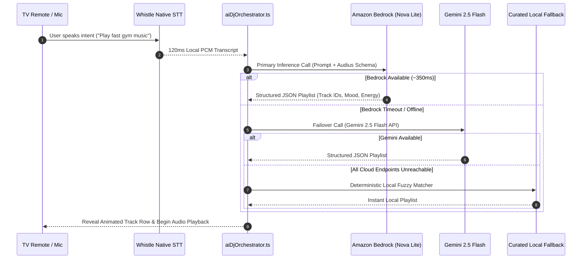

# AI DJ Screen (`AiDjScreen.tsx`) 🎙️✨

## Overview

The **AI DJ Screen** is Pandivo TV's flagship intelligence hub. It empowers users to speak natural language music requests (e.g., *"Play upbeat synthwave for late-night coding without vocals"*) directly through their TV remote, orchestrating on-device speech recognition with Amazon Bedrock Nova Lite and Gemini AI models to generate personalized, seamless track sessions.

- **Component Path:** [`FireTVMusicPOC/src/components/AiDjScreen.tsx`](../../src/components/AiDjScreen.tsx)
- **Subcomponents:** [`FireTVMusicPOC/src/components/ai-dj/`](../../src/components/ai-dj/)
  - `AIDJProcessingOverlay.tsx`: Fullscreen voice input & prompt transcription state.
  - `AIMusicVisualizer.tsx`: 60 FPS live multi-bar audio equalizer during speech processing.
  - `AIDJTrackRevealRow.tsx`: Progressive card reveal animation as songs are generated.
  - `AIDJProcessingProgress.tsx`: Multi-stage pipeline indicator (Listen -> Understand -> Mix).
- **Navigation Key:** `AI_DJ`
- **Associated Nav Rail Item:** `NAV_DJ`

---

## 🖼️ UI Layout & Visual Elements

```text
+-----------------------------------------------------------------------------------------+
| [TopHeaderBar: Pandivo Logo, Clock, Companion Avatar]                                   |
+-----------------------------------------------------------------------------------------+
|                                                                                         |
|                            +------------------------------+                             |
|                            |      [AI_DJ_MIC: 🎤]         |                             |
|                            |   Pulsing Central DJ Orb     |                             |
|                            |  Horseshoe Segment Gauge     |                             |
|                            +------------------------------+                             |
|                                                                                         |
|                            "Press OK / Mic to Start Talking"                            |
|                       "Try: Play chill lofi beats for reading"                          |
|                                                                                         |
|  [✨ AI_DJ_DIAGNOSTIC_BTN: Latency 142ms]                    [AI_DJ_VIEW_ALL: View All] |
|                                                                                         |
|  AI CREATED SESSIONS & PLAYLISTS                                                        |
|  +--------------+  +--------------+  +--------------+  +--------------+                 |
|  | [CARD_0]     |  | [CARD_1]     |  | [CARD_2]     |  | [CARD_3]     |                 |
|  | Neon Cover   |  | Cyber Cover  |  | Vibe Cover   |  | Chill Cover  |                 |
|  | Midnight Run |  | Study Chill  |  | Workout Beat |  | Coffee Break |                 |
|  | 12 Songs     |  | 8 Songs      |  | 15 Songs     |  | 10 Songs     |                 |
|  +--------------+  +--------------+  +--------------+  +--------------+                 |
|                                                                                         |
+-----------------------------------------------------------------------------------------+
| [GlobalMiniPlayer: Current Track | Scrubber | Play/Pause | Fullscreen Button]           |
+-----------------------------------------------------------------------------------------+
```

---

## 🎮 Focus ID Mapping & D-Pad Navigation

| Element Focus ID | Type | D-Pad Left | D-Pad Right | D-Pad Up | D-Pad Down | Action on Select (OK/Enter) |
|---|---|---|---|---|---|---|
| `AI_DJ_MIC` | Hero Mic Button | `NAV_DJ` (Nav Rail) | `AI_DJ_VIEW_ALL` | *Boundary* | `AI_DJ_CARD_0` | Engages Whistle STT engine & begins voice capture. |
| `AI_DJ_CANCEL_MIC`| Cancel Button | `AI_DJ_MIC` | *Boundary* | *Boundary* | `AI_DJ_CARD_0` | Aborts voice listening; restores background playback. |
| `AI_DJ_DIAGNOSTIC_BTN` | Status Pill | `NAV_DJ` | `AI_DJ_MIC` | *Boundary* | `AI_DJ_CARD_0` | Displays live Bedrock vs. Gemini latency modal. |
| `AI_DJ_VIEW_ALL` | Action Pill | `AI_DJ_MIC` | *Boundary* | *Boundary* | `AI_DJ_CARD_2` | Navigates to Library tab to browse full collection. |
| `AI_DJ_CARD_0` | History Card | `NAV_DJ` | `AI_DJ_CARD_1` | `AI_DJ_MIC` | `MINI_PLAY` (MiniPlayer) | Opens generated AI playlist in detail view. |
| `AI_DJ_CARD_{N}` | History Card | `AI_DJ_CARD_{N-1}`| `AI_DJ_CARD_{N+1}`| `AI_DJ_MIC` | `MINI_PLAY` (MiniPlayer) | Opens generated AI playlist in detail view. |

---

## ⚡ 3-Tier Multi-Model Orchestration Pipeline



---

## 🧩 Key Features & Technical Details

1. **Breathing Central Orb & Horseshoe Gauge**:
   - The microphone icon is framed by a 6-segment native vector horseshoe gauge with custom angular gradients.
   - During idle states, an Easing-based animation pulses smoothly (scale 1.0 to 1.08).
   - During voice recording, the orb shifts to active recording red (`#EF4444`) with high-frequency reactive waves.
2. **Audio Ducking & Session Continuity**:
   - When the user presses the mic button, running playback is automatically paused (`pausePlaybackForVoice()`) to guarantee clean audio capture without remote speaker feedback.
   - If the user cancels or inference completes, audio gracefully resumes or transitions into the newly generated track.
3. **Automated Error State Recovery**:
   - Contains dedicated TV error handlers:
     - `AI_DJ_ERR_NOTRACKS`: Triggered when queries ask for non-existent genres; suggests popular alternatives.
     - `AI_DJ_ERR_CONN`: Triggered on network disconnect; offers instant offline USB fallback.
     - `AI_DJ_ERR_AIDOWN`: Self-heals into local keyword matching.
